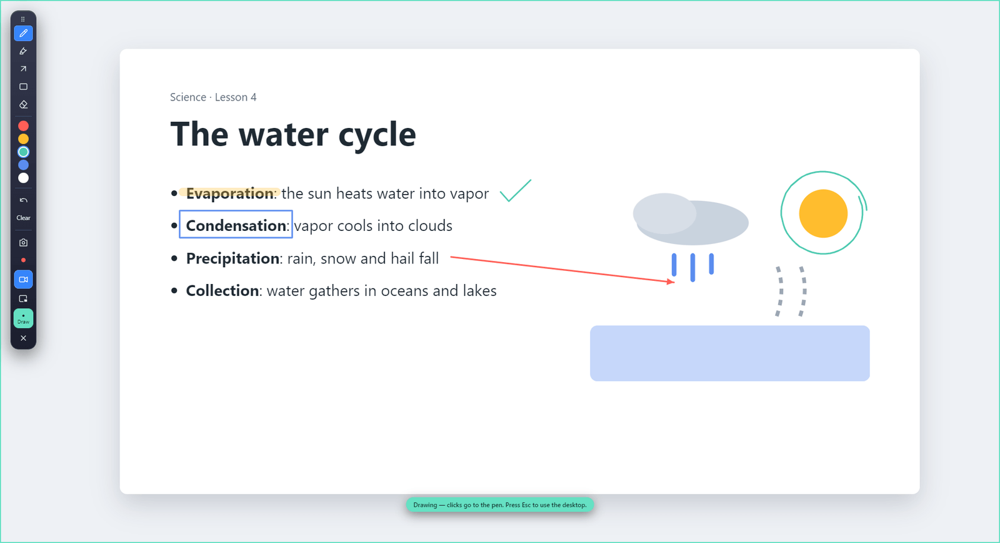

# Screen Pen for Windows

Landing page for **Screen Pen**: draw, highlight, capture and record over your Windows desktop.

- Site: https://screen-pen.vercel.app/
- Download: [Screen-Pen-Setup.exe](https://github.com/pitchiluxe/screen-pen/releases/latest/download/Screen-Pen-Setup.exe) (Windows 10/11, 64-bit)

The installer is unsigned, so Windows SmartScreen may warn about an unknown publisher. Choose **More info**, then **Run anyway**.

MIT licensed. By Erick Omari.
